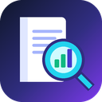

# JournalLens

**Journal rank, impact and author order from official sources only.**

A Chrome / Edge extension by **Dr. Mohammed Tawfik** · [kmkholm.github.io](https://kmkholm.github.io/) · kmkhol01@gmail.com

| What you see | Where it comes from |
|---|---|
| CiteScore, category rank (#rank/total), percentile, Scopus quartile Q1–Q4, coverage, discontinued flag | Scopus (Elsevier), read live |
| Web of Science Core Collection index (SCIE / SSCI / AHCI / ESCI) | Clarivate Master Journal List |
| Journal Impact Factor, JIF quartile, category, edition | The official JCR export you import (CSV) |
| Conference rank (A*, A, B, C) | CORE / ICORE conference portal |
| Author order (first, last, corresponding, your position) | Crossref (publisher deposit) and the publisher page |

SJR is not used.

## Install
1. Open `chrome://extensions` (or `edge://extensions`).
2. Turn on **Developer mode**.
3. Click **Load unpacked** and choose this `JournalLens` folder.
4. Pin the JournalLens icon.

## Google Scholar (runs automatically)
- **Profile pages** (`scholar.google.com/citations?user=…`):
  - a badge row under every paper: Scopus quartile + CiteScore, WoS index, IF, CORE rank, author position, DOI;
  - a statistics panel above the list: Q1–Q4 counts with share and citations, not in Scopus, conferences, preprints,
    SCIE/SSCI/ESCI/AHCI, JIF quartiles, CORE A*/A/B/C, first / last / sole author, Q1 as first author;
  - charts in the right-hand column: quartiles, papers per year by quartile, WoS donut, CORE ranks, author position;
  - click any tile to filter; "Load & analyse all papers" opens the whole list; "Copy results" copies a table for Excel/Word;
  - quartile by the latest official CiteScore or by each paper's publication year.
- **Search and "Cited by" pages**: a badge row under every result and a summary bar on top
  (your own position appears when your name is saved in Settings).

How each Scholar paper is identified: its title is searched in Crossref and accepted only on an exact (or ≥95 % for long
titles) match within ±2 years; the DOI, ISSNs and full author list come from that record. Otherwise the journal name is
used only if it matches exactly one journal. Anything else is marked **Unresolved** — nothing is guessed.

## Article pages
Open any article (ScienceDirect, Springer, IEEE, MDPI, Wiley, T&F …) and click the icon, or search by ISSN, DOI or
journal name in the popup.

## Accuracy notes
- Scopus quartile uses the Scopus definition: Q1 = 75th–99th percentile, Q2 = 50–74, Q3 = 25–49, Q4 = 0–24.
- CiteScoreTracker (current year) changes monthly and is not the official value.
- The corresponding author is shown only when the publisher page marks it explicitly.
- CORE ranks computing conferences; a conference is matched only by exact acronym or a near-identical title.
- If "Could not open a Scopus session" appears, open scopus.com once in the same browser and press Refresh.

## Speed
Results are cached (Scopus and WoS 30 days, paper matches 30 days), so reopening a profile is instant. A first full
analysis of a large profile takes a few minutes because requests are paced to stay within Scopus and Crossref limits.

## License
MIT © 2026 Dr. Mohammed Tawfik
